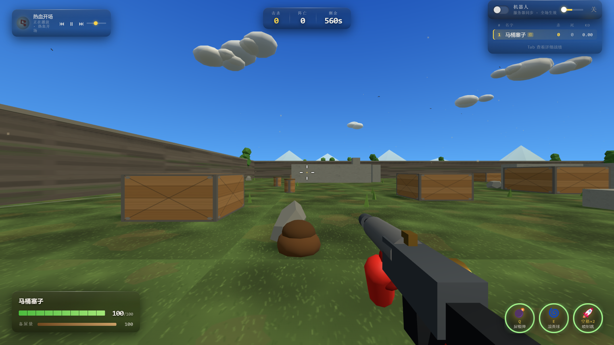

<div align="center">

# 便便英雄 · Poop Hero



**第一人称竞技场 · 2–12 人联机**

下水道大乱斗，弹药是「备屎量」。

</div>

---

## 玩法

第一人称视角的竞技场射击。场地是一圈木箱围起来的开阔地，可以跳跃、翻滚、爬箱子，靠地形和身法躲子弹。

有意思的地方在资源：**开枪、喷气飞行、扔手雷、翻滚，全部共用同一份「备屎量」**，而它恢复得很慢。所以不能一直扣扳机，得算着用——这逼着你打一段、躲一段，而不是站着对枪。

技能有三种：声波弹、滚粪球、糊视野。糊视野是给对手屏幕糊上一层，配合近身突袭很有效。

连杀在 3.5 秒内累积，鼓励一鼓作气，而不是打一枪换一个地方。

## 操作

进入游戏后点击画面锁定鼠标。

| 按键 | 作用 |
|---|---|
| `WASD` | 移动 |
| `空格` | 跳跃 |
| 鼠标 | 视角 / 瞄准 |
| 左键 | 射击（消耗备屎量） |
| `E` | 声波弹 |
| `Q` | 滚粪球 |
| `C` | 糊视野 |
| `Shift` | 翻滚闪避（有短暂无敌帧） |
| `ESC` | 释放鼠标 |

喷气飞行消耗备屎量，飞行期间无法开枪，用来抢占箱子顶部的高点。

## 核心机制

**备屎量是唯一的资源。** 所有进攻与机动手段都从同一个池子里扣，恢复速度远慢于消耗。这是整个游戏节奏的来源：什么时候开火、什么时候起飞、什么时候留着翻滚，本质上是同一个决策。

**翻滚的无敌帧按 60Hz 逐帧判定**，不是简单的"无敌几秒"。卡在正确的帧上能躲掉子弹，早一帧晚一帧都会吃伤害。

**资源在死亡时不重置**，复活才补满，所以连续送死换不到额外弹药。

## 技术架构

```
   浏览器 ◀── WebSocket ──▶ 服务端（权威 60Hz 逻辑帧）
        │                        │
   渲染 + 输入采集            重力 / 碰撞 / 射线命中
                                │
                          快照广播 20Hz
```

- **逻辑 60Hz，快照 20Hz** 分离：逻辑帧率保证判定精度，快照降频控制带宽
- 重力、碰撞、射线命中（ray-AABB）全部服务端结算，客户端只上报输入
- 客户端有本地预测，服务端位置与预测位置分叉超过阈值时柔性拉回
- 骨骼动画与姿态（`idle` / `aim` / `bent` / `down` / `fly`）由状态机切换

### 单机版（浏览器内运行）

这个项目附带一个可静态托管单机版：把 `server.js` 第 19–956 行的**纯游戏逻辑**（地图、物理、命中、技能）整体提取成 `public/src/local-server.js`，剔除 http/express/ws 依赖，由浏览器每帧推进并在本地生成同构快照。

于是客户端渲染、输入、HUD 代码一行都不用改，URL 加 `?local=1` 即启用，并自动带 5 个 AI 对手。

## 运行

需要 **Node.js 18+**。

```bash
npm install
npm start
# 浏览器打开 http://localhost:8080
```

## 素材与授权

- 代码 MIT，可自由使用、修改、商用
- 所有模型为程序化生成（几何体 + 贴图实时绘制），仓库内无外部美术素材
- 机器人名与玩家名来自原创名字池

